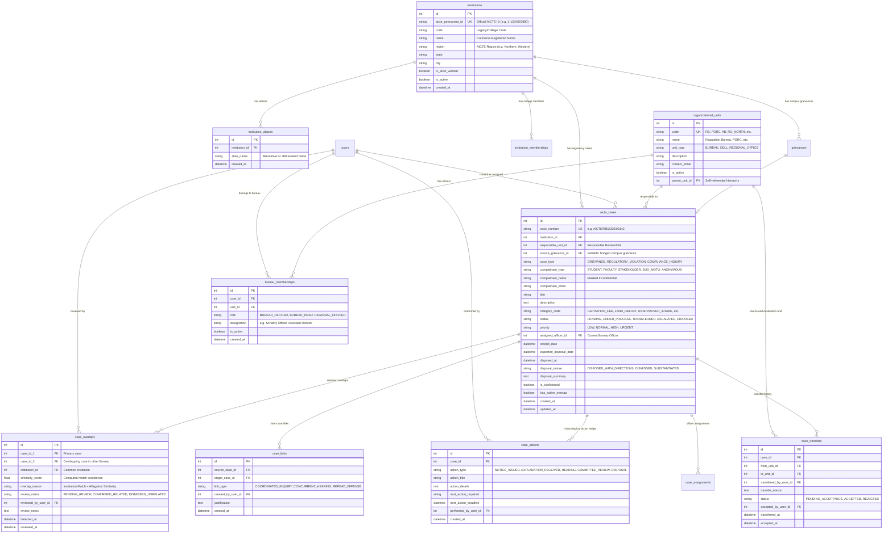
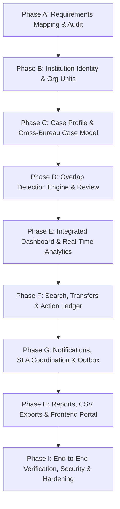

# EduResolve AI — AICTE Cross-Bureau Architecture & Design

**Problem Statement:** Integrated Dashboard for Monitoring and Tracking Institution-Related Complaint Cases Across AICTE Bureaus/Cells  
**Version:** Step 7 — Phase A Design Specification  
**Date:** October 2026  
**Status:** Approved Design Document (Read-Only Audit Phase)

---

## 1. System Design Goals & Principles

1. **Zero Regression for Campus Redressal:** Preserve the existing student and college officer workflows without breaking existing routes, schemas, database foreign keys, or test suites.
2. **Database-Backed Organizational Units:** Represent AICTE Bureaus, Cells, and Regional Offices dynamically in database tables rather than hardcoding bureau enumerations or logic.
3. **Canonical Institution Identity:** Establish unambiguous institution identification anchored on verified AICTE Permanent IDs with support for historical aliases.
4. **Independent Statutory Dockets:** Keep official cases separate between Bureaus (e.g., Regulation Bureau and PGRC maintain independent case files) while providing cross-bureau visibility, overlap alerts, and coordinated reviews.
5. **Human-in-the-Loop AI Overlap Review:** AI similarity detection is purely advisory and generates reviewable alerts. Official dockets are never automatically merged or closed by machine intelligence.
6. **Strict Multi-Tenant & Cross-Bureau Confidentiality:** Shield sensitive complainant details and confidential internal notes across bureau boundaries unless formal inter-bureau coordination is authorized.
7. **Production Database Integrity:** All schema changes must use Alembic migrations compatible with XAMPP MySQL / MariaDB (`utf8mb4`). SQLite is strictly prohibited.

---

## 2. Proposed Minimum Required Data Model

### Entity Overview & Reuse Assessment

| Entity | Purpose | Model Strategy | Justification |
| :--- | :--- | :--- | :--- |
| `institutions` | Canonical institution profile | **Extend Existing Model** | Add `aicte_permanent_id`, `region`, `is_aicte_verified`. Retains existing relationships with students and college officers. |
| `institution_aliases` | Name variation lookup | **New Table** | Maps historical and alternative institute names to the canonical institution ID to prevent missed search hits. |
| `organizational_units` | AICTE Bureaus, Cells & Regional Offices | **New Table** | Database-backed; allows dynamically adding Bureaus (RB, PGRC, Approval Bureau, Regional Offices) without code changes. |
| `bureau_memberships` | User assignments to Bureaus | **New Table** | Maps `users` to `organizational_units` with designated roles (`BUREAU_OFFICER`, `BUREAU_HEAD`, `REGIONAL_OFFICER`). |
| `aicte_cases` | Cross-bureau complaint & regulatory cases | **New Table (Bridged)** | Cleanly supports non-student complaints (faculty, stakeholder, whistleblower, regulatory inquiry) while bridging escalated campus grievances via `source_grievance_id`. |
| `case_assignments` | Bureau officer assignment history | **New Table** | Tracks assignment of bureau officers with active flag, unassignment timestamp, and reassignment rationale. |
| `case_transfers` | Inter-bureau case transfer workflow | **New Table** | Formal audit trail when transferring a case from one Bureau/Cell to another with reason and acceptance tracking. |
| `case_actions` | Chronological procedural action log | **New Table** | Records official procedural steps (Show Cause Notice, Explanation Received, Committee Review, Hearing, Compliance Verification, Disposal Order). |
| `case_overlaps` | Cross-bureau duplicate & overlap alerts | **New Table** | Persistent intelligence records flagged by AI matching engine with similarity score, match reasons, and human review status. |
| `case_links` | Cross-referenced related case records | **New Table** | Manually or confirmed linked dockets between bureaus with coordination notes. |
| `case_documents` | Case attachments & notices | **New Table / Extend Attachment** | Secure private document storage tagged by procedural action type and privacy classification. |

---

## 3. Mermaid Entity-Relationship Diagram

---

## 4. Detailed Specification of Schema Changes

---

### 4.1 Schema Modification: `institutions` Extension
- **Why It Is Necessary:** The existing `institutions` table only has `code` (`VARCHAR(50)`), which currently holds internal test codes (`NITD01`). It lacks a dedicated AICTE Permanent ID field and region tagging.
- **Can Existing Model Be Extended?** Yes. Adding columns to `institutions` preserves all existing relations (`InstitutionMembership`, `Grievance`, `RegulatoryJurisdiction`).
- **Columns to Add:**
  - `aicte_permanent_id`: `VARCHAR(50)`, nullable, unique, indexed.
  - `region`: `VARCHAR(50)`, nullable, indexed (e.g., 'NORTHERN', 'WESTERN', 'SOUTHERN', 'EASTERN', 'CENTRAL', 'NORTH-WEST', 'SOUTH-WEST').
  - `is_aicte_verified`: `BOOLEAN`, default `FALSE`, nullable=False.
- **Constraints & Indexes:**
  - `CREATE UNIQUE INDEX uq_institutions_aicte_permanent_id ON institutions (aicte_permanent_id)` (MySQL allows multiple NULLs in unique indexes).
  - `CREATE INDEX ix_institutions_region ON institutions (region)`.
- **Migration Compatibility:** 100% backward compatible. Existing records retain `aicte_permanent_id = NULL` until verified.

---

### 4.2 New Table: `institution_aliases`
- **Why It Is Necessary:** Complaints frequently use acronyms, short forms, or colloquial institute names (e.g. "NIT Delhi" vs "National Institute of Technology Delhi"). Search must resolve these to the canonical institution record to prevent duplicate profiles or missed cross-bureau matches.
- **Can Existing Model Be Extended?** No, an institution can have multiple valid aliases (one-to-many relationship).
- **Columns:**
  - `id`: `INT AUTO_INCREMENT PRIMARY KEY`.
  - `institution_id`: `INT NOT NULL`, FK to `institutions.id` ON DELETE CASCADE.
  - `alias_name`: `VARCHAR(255) NOT NULL`, indexed.
  - `created_at`: `DATETIME UTC NOT NULL`.
- **Indexes:**
  - `CREATE INDEX ix_institution_aliases_name ON institution_aliases (alias_name)`.
  - `CREATE INDEX ix_institution_aliases_inst_id ON institution_aliases (institution_id)`.

---

### 4.3 New Table: `organizational_units`
- **Why It Is Necessary:** Represents AICTE functional Bureaus (Regulation Bureau, Public Grievance Redressal Cell, Approval Bureau) and Regional Offices as database entities so that new units can be added without application code refactoring.
- **Can Existing Model Be Extended?** No existing table represents central bureaus.
- **Columns:**
  - `id`: `INT AUTO_INCREMENT PRIMARY KEY`.
  - `code`: `VARCHAR(50) UNIQUE NOT NULL`, indexed (e.g. `RB`, `PGRC`, `AB`, `RO_NORTH`).
  - `name`: `VARCHAR(150) NOT NULL` (e.g. "Regulation Bureau", "Public Grievance Redressal Cell").
  - `unit_type`: `VARCHAR(50) NOT NULL` (`BUREAU`, `CELL`, `REGIONAL_OFFICE`, `HEADQUARTERS`).
  - `description`: `TEXT`, nullable.
  - `contact_email`: `VARCHAR(255)`, nullable.
  - `is_active`: `BOOLEAN DEFAULT TRUE NOT NULL`.
  - `parent_unit_id`: `INT`, nullable, FK to `organizational_units.id` ON DELETE SET NULL.
  - `created_at`: `DATETIME UTC NOT NULL`.
  - `updated_at`: `DATETIME UTC NOT NULL`.
- **Indexes:**
  - `CREATE UNIQUE INDEX uq_org_units_code ON organizational_units (code)`.

---

### 4.4 New Table: `bureau_memberships`
- **Why It Is Necessary:** Links `User` accounts to `organizational_units`. Allows an official to hold roles such as Bureau Officer, Bureau Head, or Regional Officer within AICTE.
- **Can Existing Model Be Extended?** `InstitutionMembership` is hard-wired to college-level roles (`COLLEGE_OFFICER`, `INSTITUTION_HEAD`, `STUDENT`). Creating `bureau_memberships` avoids mixing college campus staff with central AICTE officials.
- **Columns:**
  - `id`: `INT AUTO_INCREMENT PRIMARY KEY`.
  - `user_id`: `INT NOT NULL`, FK to `users.id` ON DELETE CASCADE.
  - `unit_id`: `INT NOT NULL`, FK to `organizational_units.id` ON DELETE CASCADE.
  - `role`: `VARCHAR(50) NOT NULL` (`BUREAU_OFFICER`, `BUREAU_HEAD`, `REGIONAL_OFFICER`, `EXECUTIVE`).
  - `designation`: `VARCHAR(100)`, nullable (e.g. "Assistant Director", "Scrutiny Officer").
  - `is_active`: `BOOLEAN DEFAULT TRUE NOT NULL`.
  - `created_at`: `DATETIME UTC NOT NULL`.
  - `updated_at`: `DATETIME UTC NOT NULL`.
- **Constraints & Indexes:**
  - `CREATE UNIQUE INDEX uq_user_bureau_membership ON bureau_memberships (user_id, unit_id)`.

---

### 4.5 New Table: `aicte_cases`
- **Why It Is Necessary:** The core entity for the SIH problem statement. Represents cases across AICTE Bureaus/Cells, supports non-student initiators (faculty, stakeholders, whistleblowers, suo-motu inquiries), and links to source grievances when campus escalations occur.
- **Can Existing Model Be Extended?** No. Extending `grievances` would require breaking the `student_id` non-null constraint and overloading campus fields, risking breaking existing student features and tests.
- **Columns:**
  - `id`: `INT AUTO_INCREMENT PRIMARY KEY`.
  - `case_number`: `VARCHAR(60) UNIQUE NOT NULL`, indexed (e.g. `AICTE/RB/2026/00142`).
  - `institution_id`: `INT NOT NULL`, FK to `institutions.id` ON DELETE RESTRICT, indexed.
  - `responsible_unit_id`: `INT NOT NULL`, FK to `organizational_units.id` ON DELETE RESTRICT, indexed.
  - `source_grievance_id`: `INT`, nullable, FK to `grievances.id` ON DELETE SET NULL, indexed.
  - `case_type`: `VARCHAR(50) NOT NULL` (`REGULATORY_COMPLIANCE`, `GRIEVANCE_REDRESSAL`, `APPROVAL_INQUIRY`, `SUO_MOTU`).
  - `complainant_type`: `VARCHAR(50) NOT NULL` (`STUDENT`, `FACULTY`, `PARENT_STAKEHOLDER`, `INSTITUTION_STAFF`, `WHISTLEBLOWER`, `REGULATORY_BODY`).
  - `complainant_name`: `VARCHAR(150)`, nullable (masked if confidential).
  - `complainant_email`: `VARCHAR(255)`, nullable.
  - `complainant_phone`: `VARCHAR(30)`, nullable.
  - `title`: `VARCHAR(255) NOT NULL`, indexed.
  - `description`: `TEXT NOT NULL`.
  - `category_code`: `VARCHAR(50) NOT NULL`, indexed (e.g. `CAPITATION_FEE`, `LAND_INFRA_DEFICIT`, `UNAPPROVED_COURSES`, `FACULTY_SALARY_DUES`, `RAGGING_SAFETY`, `ADMISSION_IRREGULARITY`, `DOCUMENT_RETENTION`).
  - `status`: `VARCHAR(50) DEFAULT 'PENDING' NOT NULL`, indexed (`PENDING`, `UNDER_PROCESS`, `TRANSFERRED`, `ESCALATED`, `DISPOSED`).
  - `priority`: `VARCHAR(20) DEFAULT 'NORMAL' NOT NULL`, indexed (`LOW`, `NORMAL`, `HIGH`, `URGENT`).
  - `assigned_officer_id`: `INT`, nullable, FK to `users.id` ON DELETE SET NULL, indexed.
  - `receipt_date`: `DATETIME UTC NOT NULL`, indexed.
  - `expected_disposal_date`: `DATETIME UTC NOT NULL`, indexed.
  - `disposed_at`: `DATETIME UTC`, nullable.
  - `disposal_nature`: `VARCHAR(50)`, nullable (`SUBSTANTIATED_DIRECTIONS_ISSUED`, `COMPLIANCE_SATISFIED`, `DISMISSED_UNFOUNDED`, `TRANSFERRED_EXTERNAL`).
  - `disposal_summary`: `TEXT`, nullable.
  - `is_confidential`: `BOOLEAN DEFAULT FALSE NOT NULL`.
  - `has_active_overlap`: `BOOLEAN DEFAULT FALSE NOT NULL`, indexed.
  - `last_action_text`: `VARCHAR(255)`, nullable.
  - `last_action_date`: `DATETIME UTC`, nullable.
  - `next_action_text`: `VARCHAR(255)`, nullable.
  - `next_action_deadline`: `DATETIME UTC`, nullable.
  - `created_at`: `DATETIME UTC NOT NULL`, indexed.
  - `updated_at`: `DATETIME UTC NOT NULL`.
- **Indexes:**
  - `CREATE UNIQUE INDEX uq_aicte_cases_case_num ON aicte_cases (case_number)`.
  - `CREATE INDEX ix_aicte_cases_inst_status ON aicte_cases (institution_id, status)`.
  - `CREATE INDEX ix_aicte_cases_unit_status ON aicte_cases (responsible_unit_id, status)`.
  - `CREATE INDEX ix_aicte_cases_dates ON aicte_cases (receipt_date, expected_disposal_date)`.

---

### 4.6 New Table: `case_transfers`
- **Why It Is Necessary:** Inter-bureau case transfer is a primary problem statement requirement (e.g., PGRC transferring a case to Regulation Bureau upon identifying unauthorized program intake).
- **Columns:**
  - `id`: `INT AUTO_INCREMENT PRIMARY KEY`.
  - `case_id`: `INT NOT NULL`, FK to `aicte_cases.id` ON DELETE CASCADE, indexed.
  - `from_unit_id`: `INT NOT NULL`, FK to `organizational_units.id` ON DELETE RESTRICT.
  - `to_unit_id`: `INT NOT NULL`, FK to `organizational_units.id` ON DELETE RESTRICT.
  - `transferred_by_user_id`: `INT NOT NULL`, FK to `users.id` ON DELETE RESTRICT.
  - `transfer_reason`: `TEXT NOT NULL`.
  - `status`: `VARCHAR(30) DEFAULT 'PENDING_ACCEPTANCE' NOT NULL` (`PENDING_ACCEPTANCE`, `ACCEPTED`, `REJECTED`).
  - `accepted_by_user_id`: `INT`, nullable, FK to `users.id` ON DELETE SET NULL.
  - `transferred_at`: `DATETIME UTC NOT NULL`.
  - `accepted_at`: `DATETIME UTC`, nullable.

---

### 4.7 New Table: `case_actions`
- **Why It Is Necessary:** Captures official procedural milestones (e.g., Show Cause Notice issued, Institute response received, Hearing scheduled, Expert Committee inquiry, Disposal Order) distinct from simple status transitions.
- **Columns:**
  - `id`: `INT AUTO_INCREMENT PRIMARY KEY`.
  - `case_id`: `INT NOT NULL`, FK to `aicte_cases.id` ON DELETE CASCADE, indexed.
  - `action_type`: `VARCHAR(50) NOT NULL` (`SHOW_CAUSE_NOTICE`, `EXPLANATION_RECEIVED`, `COMMITTEE_REVIEW`, `HEARING_HELD`, `COMPLIANCE_VERIFIED`, `INTERIM_ORDER`, `DISPOSAL_ORDER`).
  - `action_title`: `VARCHAR(255) NOT NULL`.
  - `action_details`: `TEXT NOT NULL`.
  - `next_action_required`: `VARCHAR(255)`, nullable.
  - `next_action_deadline`: `DATETIME UTC`, nullable.
  - `performed_by_user_id`: `INT NOT NULL`, FK to `users.id` ON DELETE RESTRICT.
  - `created_at`: `DATETIME UTC NOT NULL`, indexed.

---

### 4.8 New Table: `case_overlaps`
- **Why It Is Necessary:** Stores intelligence generated by the cross-bureau overlap detection engine. Alerts officers when an institution has active complaints in multiple Bureaus simultaneously.
- **Columns:**
  - `id`: `INT AUTO_INCREMENT PRIMARY KEY`.
  - `case_id_1`: `INT NOT NULL`, FK to `aicte_cases.id` ON DELETE CASCADE, indexed.
  - `case_id_2`: `INT NOT NULL`, FK to `aicte_cases.id` ON DELETE CASCADE, indexed.
  - `institution_id`: `INT NOT NULL`, FK to `institutions.id` ON DELETE CASCADE, indexed.
  - `similarity_score`: `FLOAT NOT NULL`.
  - `overlap_reason`: `TEXT NOT NULL` (e.g. "Institution-matched concurrent active dockets in RB and PGRC with overlapping allegations regarding unauthorized fees").
  - `review_status`: `VARCHAR(30) DEFAULT 'PENDING_REVIEW' NOT NULL`, indexed (`PENDING_REVIEW`, `CONFIRMED_RELATED`, `DISMISSED_UNRELATED`).
  - `reviewed_by_user_id`: `INT`, nullable, FK to `users.id` ON DELETE SET NULL.
  - `review_notes`: `TEXT`, nullable.
  - `detected_at`: `DATETIME UTC NOT NULL`, indexed.
  - `reviewed_at`: `DATETIME UTC`, nullable.
- **Constraints & Indexes:**
  - `CREATE UNIQUE INDEX uq_case_overlap_pair ON case_overlaps (case_id_1, case_id_2)`.

---

### 4.9 New Table: `case_links`
- **Why It Is Necessary:** Supports official manual linking of related cases across bureaus after human review, maintaining an interconnected dossier for high-risk institutions without merging independent legal records.
- **Columns:**
  - `id`: `INT AUTO_INCREMENT PRIMARY KEY`.
  - `source_case_id`: `INT NOT NULL`, FK to `aicte_cases.id` ON DELETE CASCADE, indexed.
  - `target_case_id`: `INT NOT NULL`, FK to `aicte_cases.id` ON DELETE CASCADE, indexed.
  - `link_type`: `VARCHAR(50) DEFAULT 'RELATED_PROCEEDING' NOT NULL` (`RELATED_PROCEEDING`, `COORDINATED_HEARING`, `REPEAT_OFFENSE_EVIDENCE`).
  - `justification`: `TEXT NOT NULL`.
  - `created_by_user_id`: `INT NOT NULL`, FK to `users.id` ON DELETE RESTRICT.
  - `created_at`: `DATETIME UTC NOT NULL`.
- **Constraints & Indexes:**
  - `CREATE UNIQUE INDEX uq_case_links_pair ON case_links (source_case_id, target_case_id)`.

---

## 5. Security & Privacy Architecture

### 5.1 Privacy-Preserving Cross-Bureau Data Masking
When Officer $O_{RB}$ in Regulation Bureau views an overlap alert involving Case $C_{PGRC}$ in PGRC:
- **Exposed Metadata:** Case Number (`AICTE/PGRC/2026/0089`), Institution Name, Category Code, Status (`UNDER_PROCESS`), Similarity Score, Date of Receipt.
- **Shielded Confidential Data:** Complainant Name, Complainant Phone/Email, Exact Student Identity, Internal Notes of PGRC, and Confidential Attachments remain **REDACTED**.
- **Access Escalation:** If joint review is required, the officers must initiate a formal **Coordinated Hearing / Case Link** action approved by their respective Bureau Heads.

### 5.2 Permission Matrix

| Role | Campus Grievances | Assigned Bureau Cases | Other Bureau Overlaps | Inter-Bureau Transfer | High-Level AICTE Dashboard | Case Disposal |
| :--- | :---: | :---: | :---: | :---: | :---: | :---: |
| **Student** | Own Only | No Access | No Access | No Access | No Access | Close/Reopen Own |
| **College Officer** | Own College | No Access | No Access | No Access | No Access | College Level |
| **Institution Head** | Own College | View Notice Only | No Access | No Access | No Access | College Level |
| **AICTE Bureau Officer** | Escalated View | Full Edit/Action | Metadata Only | Propose Transfer | Bureau Level | Propose Disposal |
| **AICTE Bureau Head** | Escalated View | Full Approval | Metadata Only | Approve Transfer | Bureau Level | Approve Disposal |
| **AICTE Regional Officer** | Regional View | Regional Cases | Regional Metadata | Propose Transfer | Regional Level | Regional Disposal |
| **AICTE Member Secretary** | Full View | Holistic Read | Full Cross-Bureau | Apex Approval | Pan-India Executive | Apex Orders |
| **Super Admin** | System Admin | System Admin | System Admin | Tech Admin | System Telemetry | System Admin |

---

## 6. Phased Implementation Roadmap (Phases B to I)

The implementation must proceed sequentially. Each phase builds on strictly validated prerequisites, preserving database state and user accounts.

---

### Phase B: Institution Identity and Organizational Units [COMPLETED]
- **Primary Goal:** Establish verified AICTE Permanent IDs, alias lookup, and database-backed Bureau/Cell entities.
- **Dependencies:** Phase A completed.
- **Status:** **COMPLETED** (October 2026)
- **Delivered Files:**
  - Migration: `backend/alembic/versions/c7b12d3e4f5a_step7_phase_b_institutions_and_bureau_units.py` (parent: `59f5f8fb2f6b`)
  - Backend Models: `backend/app/models/organizational_unit.py`, `backend/app/models/bureau_membership.py`, `backend/app/models/institution.py` (extended with `InstitutionAlias`, `aicte_permanent_id`, `region`, `is_aicte_verified`)
  - Backend Schemas: `backend/app/schemas/organizational_unit.py`, `backend/app/schemas/institution.py`
  - Backend APIs: `backend/app/api/v1/organizational_units.py`, `backend/app/api/v1/institutions.py`
  - Seeding: `backend/app/services/bootstrap_service.py` (`seed_organizational_units`), `backend/seed_data.py`
  - Tests: `backend/app/tests/test_step7_phase_b_institutions_and_org_units.py` (10 automated unit & permission tests)
  - Frontend: `frontend/src/types/index.ts`, `frontend/src/pages/superadmin/SuperAdminDashboard.tsx`, `frontend/src/components/common/Sidebar.tsx`, `frontend/src/routes/AppRoutes.tsx`
- **Implemented Endpoints:**
  - `GET /api/v1/institutions` (supports multi-parameter search by code, name, alias, AICTE ID, region, and verification status)
  - `POST /api/v1/institutions/{id}/verify-aicte` (authorized SuperAdmin verification of AICTE Permanent ID with audit logging)
  - `GET /api/v1/institutions/{id}/aliases` (list registered aliases)
  - `POST /api/v1/institutions/{id}/aliases` (create alias with source and verification flag)
  - `DELETE /api/v1/institutions/{id}/aliases/{alias_id}` (delete/deactivate alias)
  - `GET /api/v1/organizational-units` (list active AICTE units with member counts)
  - `POST /api/v1/organizational-units` (create unit with hierarchy cycle validation)
  - `PUT /api/v1/organizational-units/{id}` (update unit / toggle active)
  - `POST /api/v1/organizational-units/seed-defaults` (idempotently seed baseline units)
  - `GET /api/v1/organizational-units/{id}/members` (list assigned bureau staff)
  - `POST /api/v1/organizational-units/{id}/members` (assign personnel to bureau)
  - `DELETE /api/v1/organizational-units/{id}/members/{membership_id}` (revoke bureau membership)
- **Database Schema Changes:**
  - Added `aicte_permanent_id` (VARCHAR(50), nullable, unique, indexed) to `institutions`.
  - Added `region` (VARCHAR(50), nullable, indexed) to `institutions`.
  - Added `is_aicte_verified` (Boolean, default False) to `institutions`.
  - Created table `institution_aliases` with unique constraint `uq_institution_normalized_alias`.
  - Created table `organizational_units` with unique constraint on `code` and self-referential FK `parent_unit_id`.
  - Created table `bureau_memberships` with unique constraint `uq_user_bureau_membership`.
- **Seeded Baseline Units:**
  - `RB` — Regulation Bureau (BUREAU)
  - `PGRC` — Public Grievance Redressal Cell (CELL)
  - `AB` — Approval Bureau (BUREAU)
  - `RO_NORTH` — Regional Office, North (REGIONAL_OFFICE)
  - `RO_WEST` — Regional Office, West (REGIONAL_OFFICE)
  - `RO_SOUTH` — Regional Office, South (REGIONAL_OFFICE)
- **Acceptance Verification:**
  - 104 backend tests passing cleanly against `eduresolve_ai_test` in XAMPP MySQL.
  - Zero regression in pre-existing student grievance submission and college officer workflows.
  - Frontend production build passed cleanly (`vite build` -> 0 errors).

---

### Phase C: Institution-Centric Case Profile and Cross-Bureau Case History (Completed)
- **Primary Goal:** Implement dedicated AICTE case entity, procedural action history ledger, and institution consolidated case history.
- **Migration Revision:** `d8c23e4f5a6b` (Parent: `c7b12d3e4f5a`)
- **Status:** **PHASE C COMPLETED**
- **Delivered Files:**
  - Backend: `backend/alembic/versions/d8c23e4f5a6b_step7_phase_c_aicte_cases_and_actions.py`
  - Backend: `backend/app/models/aicte_case.py` (`AICTECase` and `CaseAction` models)
  - Backend: `backend/app/schemas/aicte_case.py` (Pydantic v2 schemas)
  - Backend: `backend/app/api/v1/aicte_cases.py` (APIs mounted under `/api/v1/aicte`)
  - Tests: `backend/app/tests/test_step7_phase_c_aicte_cases.py` (10 tests, 100% passing)
  - Frontend: `frontend/src/pages/aicte/ProceduralActionLog.tsx`
  - Frontend: `frontend/src/pages/aicte/ProceduralActionModal.tsx`
  - Frontend: `frontend/src/pages/aicte/CreateAICTECaseModal.tsx`
  - Frontend: `frontend/src/pages/aicte/ReferGrievanceModal.tsx`
  - Frontend: `frontend/src/pages/aicte/AICTECaseList.tsx`
  - Frontend: `frontend/src/pages/aicte/AICTECaseDetail.tsx`
  - Frontend: `frontend/src/pages/aicte/AICTEInstitutionProfile.tsx`
  - Frontend: `frontend/src/pages/aicte/AICTEIntegratedDashboard.tsx`
- **Implemented API Endpoints:**
  - `GET /api/v1/aicte/cases` (authorized case list, search & multi-criteria filtering with Bureau-scoped RBAC)
  - `POST /api/v1/aicte/cases` (direct intake with unique collision-free reference generation)
  - `GET /api/v1/aicte/cases/{case_id}` (case docket details & chronological actions)
  - `PATCH /api/v1/aicte/cases/{case_id}` (update permitted metadata)
  - `POST /api/v1/aicte/cases/{case_id}/assign` (assign or reassign handling unit & officer)
  - `POST /api/v1/aicte/cases/{case_id}/actions` (append procedural milestone with lifecycle state machine validation)
  - `GET /api/v1/aicte/cases/{case_id}/history` (retrieve case procedural history)
  - `POST /api/v1/aicte/cases/refer-grievance` (campus grievance referral with duplicate prevention)
  - `GET /api/v1/aicte/institutions/{id}/consolidated-history` (cross-bureau institution profile)
- **Database Schema Changes:**
  - Created table `aicte_cases` with foreign keys to `institutions`, `organizational_units`, `grievances` (`source_grievance_id`), and `users`.
  - Created table `case_actions` with foreign keys to `aicte_cases`, `organizational_units`, and `users`.
- **Acceptance Verification:**
  - 114 backend tests passing cleanly against `eduresolve_ai_test` in XAMPP MySQL.
  - Zero regression in pre-existing student grievance submission and college officer workflows.
  - Frontend production build passed cleanly (`vite build` -> 0 errors).

---

### Phase D: Overlap Detection, Related-Case Linking, and Human Review
- **Primary Goal:** Implement automated cross-bureau overlap detection, privacy-preserving alerts, and human review actions.
- **Migration Revision:** `e9f34a5b6c7d` (Parent: `d8c23e4f5a6b`)
- **Status:** **PHASE D COMPLETED**
- **Delivered Files:**
  - AI Service / Algorithm: `backend/app/services/aicte_overlap_service.py` (Multi-signal similarity engine)
  - Backend: `backend/app/models/aicte_overlap.py` (`AICTECaseOverlap` and `AICTECaseLink`)
  - Backend: `backend/app/schemas/aicte_overlap.py`
  - Backend: `backend/app/api/v1/aicte_overlaps.py`
  - Frontend: `frontend/src/pages/aicte/AICTEOverlapQueue.tsx`
  - Frontend: `frontend/src/pages/aicte/AICTEOverlapDetail.tsx`
  - Frontend: `frontend/src/pages/aicte/AICTECaseRelationships.tsx`
  - Tests: `backend/app/tests/test_step7_phase_d_overlap_detection.py` (10 tests, 100% passing)
- **API Endpoints:**
  - `POST /api/v1/aicte/cases/{id}/detect-overlaps` (run cross-bureau overlap detection)
  - `GET /api/v1/aicte/overlaps/pending` (queue of unreviewed cross-bureau overlap alerts)
  - `GET /api/v1/aicte/overlaps/{id}` (detailed overlap report with similarity breakdown)
  - `POST /api/v1/aicte/overlaps/{id}/review` (confirm or dismiss match with mandatory notes)
  - `POST /api/v1/aicte/cases/{id}/links` (link cases without merging dockets)
  - `GET /api/v1/aicte/cases/{id}/links` (list linked cases)
- **Database Schema Changes:**
  - Created table `aicte_case_overlaps` with unique canonical pair constraint `case_a_id < case_b_id`.
  - Created table `aicte_case_links` for administrative linking.
- **Acceptance Verification:**
  - 124 backend tests passing cleanly against `eduresolve_ai_test` in XAMPP MySQL.

---

### Phase E: Formal Inter-Bureau Transfer, Acceptance and Rejection Workflow
- **Primary Goal:** Implement a formal, auditable inter-Bureau case transfer workflow across AICTE organizational units (Regulation Bureau [RB], Public Grievance Redressal Cell [PGRC], Approval Bureau [AB], and Regional Offices).
- **Migration Revision:** `f0a45b6c7d8e` (Parent: `e9f34a5b6c7d`)
- **Status:** **PHASE E COMPLETED**
- **Delivered Files:**
  - Backend Migration: `backend/alembic/versions/f0a45b6c7d8e_step7_phase_e_aicte_case_transfers.py`
  - Backend Model: `backend/app/models/aicte_transfer.py` (`AICTECaseTransfer`)
  - Backend Schemas: `backend/app/schemas/aicte_transfer.py` (Pydantic v2 schemas)
  - Backend Service: `backend/app/services/aicte_transfer_service.py` (`AICTETransferService`)
  - Backend API: `backend/app/api/v1/aicte_transfers.py` (mounted at `/api/v1/aicte`)
  - Direct Assignment Protection: `backend/app/api/v1/aicte_cases.py` (guarded `/cases/{id}/assign` against bypassing transfers)
  - Tests: `backend/app/tests/test_step7_phase_e_aicte_transfers.py` (14 tests, 100% passing)
  - Frontend Types: `frontend/src/types/index.ts`
  - Frontend Modals: `frontend/src/pages/aicte/InitiateTransferModal.tsx`, `frontend/src/pages/aicte/TransferDecisionModal.tsx`
  - Frontend Pages: `frontend/src/pages/aicte/AICTETransferQueue.tsx`
  - Frontend Enhancements: `frontend/src/pages/aicte/AICTECaseDetail.tsx` (Transfer ledger & banner), `frontend/src/pages/aicte/AICTEIntegratedDashboard.tsx`, `frontend/src/components/common/Sidebar.tsx`
- **Implemented API Endpoints:**
  - `POST /api/v1/aicte/cases/{case_id}/transfers` (initiate transfer proposal)
  - `GET /api/v1/aicte/cases/{case_id}/transfers` (retrieve case transfer history)
  - `GET /api/v1/aicte/transfers/incoming` (paginated incoming queue for destination bureau)
  - `GET /api/v1/aicte/transfers/outgoing` (paginated outgoing queue for originating bureau)
  - `GET /api/v1/aicte/transfers/{transfer_id}` (detailed transfer proposal and context)
  - `POST /api/v1/aicte/transfers/{transfer_id}/accept` (atomically accept transfer & reassign unit/officer)
  - `POST /api/v1/aicte/transfers/{transfer_id}/reject` (reject with required reason & restore prior status)
  - `POST /api/v1/aicte/transfers/{transfer_id}/cancel` (withdraw proposal before decision)
- **Database Schema Changes:**
  - Created table `aicte_case_transfers` with foreign keys to `aicte_cases`, `organizational_units` (`from_unit_id`, `to_unit_id`), and `users`.
  - Added Check Constraint `ck_case_transfer_distinct_units` (`from_unit_id != to_unit_id`).
  - Added new enum values: `AICTETransferStatusEnum` (`PENDING_ACCEPTANCE`, `ACCEPTED`, `REJECTED`, `CANCELLED`), and `AICTECaseActionTypeEnum` additions (`TRANSFER_REJECTED`, `TRANSFER_CANCELLED`).
- **Transfer Lifecycle Invariants:**
  1. *Transfer is a controlled handover of responsibility* — not a merge, disposal, or deletion.
  2. *Originating Bureau retains responsibility until acceptance* — `case.current_unit_id` and assigned officer remain unchanged while status is `TRANSFER_PENDING`.
  3. *Exact prior status restoration* — on rejection or cancellation, `case.status` is restored to `prior_case_status` (not defaulted to `UNDER_PROCESS`).
  4. *Row-level concurrency locks & duplicate prevention* — prevents simultaneous accept/reject races and duplicate pending proposals (HTTP 409).
  5. *Notification outbox integration* — transactionally queues notification events without leaking confidential narratives across bureaus.
- **Acceptance Verification:**
  - 14 dedicated Phase E tests passing cleanly against `eduresolve_ai_test` in XAMPP MariaDB.
  - Full backend regression suite: **138 tests passing (100%), 0 failures**.
  - Frontend production build (`npm run build`): Exit code 0, 0 TypeScript errors.

---

### Phase F: Consolidated AICTE Analytics, Case Ageing, SLA Monitoring and Reporting
- **Primary Goal:** Implement a comprehensive, data-driven analytical and reporting layer across AICTE Bureaus, Cells, and Regional Offices.
- **Status:** **PHASE F COMPLETED**
- **Delivered Files:**
  - Backend Service: `backend/app/services/aicte_analytics_service.py` (`AICTEAnalyticsService`)
  - Backend Schemas: `backend/app/schemas/aicte_analytics.py` (Pydantic v2 analytical schemas)
  - Backend API: `backend/app/api/v1/aicte_analytics.py` (mounted at `/api/v1/aicte/analytics`)
  - Frontend Workspace: `frontend/src/pages/aicte/AICTEIntegratedDashboard.tsx`
  - Frontend Types: `frontend/src/types/index.ts`
  - Tests: `backend/app/tests/test_step7_phase_f_analytics.py` (14 tests, 100% passing)
- **Implemented API Endpoints:**
  - `GET /api/v1/aicte/analytics/overview` (summary KPIs, active backlog, status distribution)
  - `GET /api/v1/aicte/analytics/ageing` (active-case ageing bands: 0–7d, 8–15d, 16–30d, 31–60d, >60d)
  - `GET /api/v1/aicte/analytics/sla` (overdue actions, overdue expected disposal dates, missing deadline tracking)
  - `GET /api/v1/aicte/analytics/institutions` (institution-wise workload ranking and active/overdue metrics)
  - `GET /api/v1/aicte/analytics/organizational-units` (Bureau/Cell/Regional Office caseload breakdown)
  - `GET /api/v1/aicte/analytics/trends` (6-month chronological intake, disposal, and transfer trends)
  - `GET /api/v1/aicte/analytics/transfers` (inter-Bureau transfer volume, acceptance rates, turnaround hours)
  - `GET /api/v1/aicte/analytics/cross-bureau` (overlap alerts and confirmed case link metrics)
  - `GET /api/v1/aicte/analytics/reports/cases.csv` (authorized case report export with formula injection sanitization)
  - `GET /api/v1/aicte/analytics/reports/summary.csv` (authorized aggregate KPI summary export)
- **Analytical & Performance Invariants:**
  1. *Server-Side Aggregation*: Database-level `COUNT(DISTINCT ...)`, `GROUP BY`, and `DATEDIFF` avoid join multiplication and excessive memory usage.
  2. *Role-Scoped RBAC*: `SUPER_ADMIN` has nationwide visibility; `REGULATORY_ADMIN` is scoped by jurisdiction states/institutions; Bureau officers are strictly scoped to their authorized units.
  3. *Accurate Ageing Calculation*: Active backlog ageing is calculated only for non-disposed cases; historical disposal times are tracked separately.
  4. *Zero Denominator Protection*: Disposal rate calculations return safe `None` when no cases were received in the period, preventing division-by-zero crashes.
  5. *Formula Injection Defense*: CSV exports neutralize `=, +, -, @, \t, \r` characters via single-quote prepending.
- **Acceptance Verification:**
  - 14 dedicated Phase F tests passing cleanly against `eduresolve_ai_test` in XAMPP MySQL.
  - Full backend regression suite: **152 tests passing (100%), 0 failures**.
  - Frontend production build (`npm run build`): Exit code 0, 0 TypeScript errors.

---

### Phase G: Centralized AICTE Alert Center, Notifications and Escalation Management (COMPLETED)
- **Primary Goal:** Role-aware centralized alert and notification hub for AICTE case operations, integrating SLA scheduling, transfer alerts, overlap alerts, and administrative error monitoring without altering official case procedural status.
- **Dependencies:** Phases B through F.
- **Delivered Files:**
  - Database Migration: `backend/alembic/versions/g1b23c4d5e6f_step7_phase_g_notification_lifecycle.py`
  - Backend Service: `backend/app/services/aicte_alert_service.py`
  - Backend API: `backend/app/api/v1/aicte_notifications.py`
  - Backend Schemas: `backend/app/schemas/aicte_alert.py`
  - Scheduler Extension: `backend/app/services/scheduler.py` (integrated `AICTEAlertService.scan_and_generate_sla_alerts`)
  - Frontend Page: `frontend/src/pages/aicte/AICTENotificationCenter.tsx`
  - Frontend Component: `frontend/src/components/aicte/AICTENotificationBell.tsx`
  - Frontend Dashboard Integration: `frontend/src/pages/aicte/AICTEIntegratedDashboard.tsx`
  - Automated Tests: `backend/app/tests/test_step7_phase_g_alerts.py`
- **Delivered API Endpoints:**
  - `GET /api/v1/aicte/notifications` (paginated, filtered by category, severity, read state, ack state)
  - `GET /api/v1/aicte/notifications/unread-count` (real-time badge count)
  - `GET /api/v1/aicte/notifications/{id}` (authorized detail)
  - `POST /api/v1/aicte/notifications/{id}/read` (mark as read without altering case state)
  - `POST /api/v1/aicte/notifications/{id}/acknowledge` (formal review confirmation with timestamp)
  - `POST /api/v1/aicte/notifications/read-all` (mark caller's eligible notifications read)
  - `GET /api/v1/aicte/alerts/summary` (live counters by category, severity, and active queues)
  - `GET /api/v1/aicte/alerts/overdue` (active overdue cases categorized by Next Action, Disposal, or Both)
  - `GET /api/v1/aicte/alerts/configuration` (read permitted alert thresholds)
  - `PATCH /api/v1/aicte/alerts/configuration` (audited administrative threshold updates)
- **Acceptance Verification:**
  - 10 dedicated Phase G tests passing cleanly against `eduresolve_ai_test` in XAMPP MySQL.
  - Complete backend regression suite: **162 tests passing (100%), 0 failures in 32.71s**.
  - Frontend production build (`npm run build`): Exit code 0, 0 TypeScript errors.

---

### Phase H: Reports, Exports, and Frontend Integration
- **Primary Goal:** Comprehensive AICTE compliance reporting, formula injection safe CSV exports, and full UI polish.
- **Dependencies:** Phase G.
- **Expected Files:**
  - Backend: `backend/app/api/v1/aicte_reports.py`
  - Frontend: `frontend/src/pages/aicte/AICTEReportsPage.tsx`
  - Frontend: `frontend/src/routes/AppRoutes.tsx` (mount `/aicte/*` routes)
- **API Changes:**
  - `GET /api/v1/aicte/reports/ageing`
  - `GET /api/v1/aicte/reports/disposal-rate`
  - `GET /api/v1/aicte/reports/export/csv` (sanitized CSV stream)
- **Acceptance Criteria:**
  - CSV export conforms to spreadsheet security standards (formula injection blocked).
  - Responsive, accessible frontend adhering to design tokens.

---

### Phase I: End-to-End Testing, Security Review, and Deployment Readiness
- **Primary Goal:** Automated regression testing, performance validation, and security audit.
- **Dependencies:** Phases B through H.
- **Expected Files:**
  - Tests: `backend/app/tests/test_aicte_cross_bureau.py`
  - Tests: `backend/app/tests/test_aicte_overlap_detection.py`
  - Tests: `backend/app/tests/test_aicte_dashboard_analytics.py`
  - Docs: `docs/STEP7_VERIFICATION_REPORT.md`
- **Acceptance Criteria:**
  - All automated test suites pass cleanly against `eduresolve_ai_test` in XAMPP MySQL.
  - Zero regression in pre-existing student and college officer tests.
  - Verified multi-tenant data boundaries under security audit.
